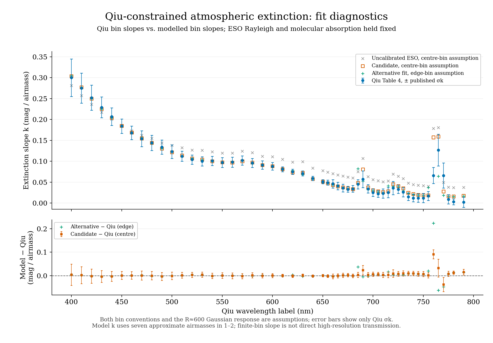
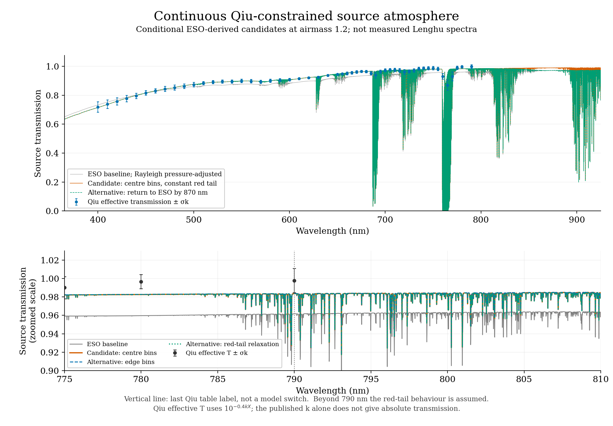

# Qiu 消光约束的连续大气透射候选模型

记录日期：2026-11-15。这里生成的是 **条件化研究候选**，不是经过现场验证的完整 4200 m 大气模型；未替换先前的 ETC 输入，也没有重跑 Redrock 或更新曝光成功率。

## 与 4200 m 天光的关系

此前的亮夜和暗夜 4200 m 产物是到达地面的**天空辐亮度**，由 ESO 多高度天空分量外推并作宽带归一化；没有生成 4200 m 的外源透射率。详情见 4200 m 天光记录（完整记录保存在 Gravity 历史归档）。这里的模型描述天体光在大气中的**透射率**，两者是不同物理量。本候选不重新计算天空辐亮度，也不应把源透射率再乘到已到达地面的天空光上。亮夜、暗夜试运行确认天空电子数与冻结输入一致，但天空外推和新透射模型的物理自洽性仍未由冷湖实测验证。

## 输入和拟合

- 文献数据：Qiu 等 2026 年[表 4](https://arxiv.org/html/2606.18804v1#S4.T4) 的 53 个消光斜率 `k` 及 `σ_k`，波长标记 400–790 nm。作者对有限波宽内的透射率取平均，再拟合 `A_i(X) = b_i + k_i X`；表格不提供 `b_i`、逐夜的全部输入或跨波长协方差。`σ_k` 的确切统计口径也不能由表格单独确定。
- 基础光谱：原 ESO 3060 m 参考大气（airmass = 1.2，0.01 nm 网格），其中瑞利光学深度按 613.3/708 的气压比修正；前者为论文采用的 460 mmHg 典型气压。ESO 的分子吸收、臭氧和 Mie 气溶胶仍不是冷湖现场测量。
- 保留**瑞利散射和 ESO 分子吸收**，对臭氧与 Mie 两个分量的合并光学深度施加正的、波长平滑的倍率。若原始各分量在 X=1.2 的透射率依次为 `T_mol`、`T_R`、`T_O3`、`T_Mie`，候选为：

  `T = T_mol × T_R × (T_O3 × T_Mie) ** exp(s(λ))`。

  这里的 `s` 是 400–790 nm 上每 30 nm 设置节点的 clamped cubic spline；对两端导数取零，并在表外采用明确的延伸假设，因此没有在 790 nm 另行拼接。模型保持 `0 ≤ T ≤ 1`。臭氧和气溶胶的合并倍率不是这两种物质各自的独立测量。
- 为尽量比较同一统计量，假定光学深度随 airmass 线性缩放，计算 X=1–2 的 7 个模型光谱；以 Gaussian `R≈600` 近似 Qiu 仪器，假定该窄波段内参考星的输入连续谱局部平坦，再对 5 或 10 nm 分箱结果的 `A_i` 拟合斜率。真实仪器 LSF、逐曝光 airmass 和恒星谱细节没有完全恢复。
- 表格波长标签是否代表 bin 中心没有明确说明。主方案**假定中心**；另对**左边界**假设独立重拟合。650 nm 恰好落在论文宽度定义的分界，本次明确取 5 nm。两种都是假设，不是由拟合优劣证明的事实；Qiu 波长的空气／真空口径也未确定。
- 拟合目标采用表格 `σ_k` 与 0.005 mag/airmass 工程误差底噪的平方和开方加权，并对 spline 的二阶差分和偏离 ESO 模型施加弱约束；这些惩罚参数是工程选择，不是现场测得的不确定度。

## 结果与限制

在 bin 中心假设下，对全部 53 个表项的样本内平均绝对 k 残差从 **0.0262** 降至 **0.00678 mag/airmass**。这只是对拟合所用表格的拟合优度，不代表独立观测精度。把每第五个表项暂时留出再拟合时，11 个留出点的平均绝对残差从 0.0323 降至 0.0126；相邻波段和原观测可能相关，不能把它当作独立观测验收。

仍存在重要不一致：

- 760 nm 的 Qiu `k = 0.066 ± 0.019`，主方案模型约为 0.157 mag/airmass；左边界方案约 0.289。强 O₂ 吸收区对分箱位置、分辨率和分子模型很敏感，不能用一个平滑连续谱修正唯一确定窄分子线。
- 在 790 nm，Qiu `k = 0.002 ± 0.012`，而按假定压力修正的 ESO 瑞利散射单独就约为 0.0144 mag/airmass。主方案的分箱预测 `k≈0.0174`；模型在该标记处的高分辨率 `T≈0.984`，原参考约 0.962。Qiu 的 `k` 和单点高分辨率 `T` 不属于完全相同的统计量。
- 为尽量贴近红端表项，主方案在 790 nm 将 ESO 的**臭氧与 Mie 合并光学深度**压到参考的约 **2.7%**。这不是对冷湖臭氧或气溶胶的实测定标，反而表明结果对该条件化参数化非常敏感。
- 790 nm 以上缺少 Qiu 表格约束。主候选延续边界倍率；另一候选从 790 到 870 nm 平滑回到原 ESO 倍率。二者是两个可复核的假设，**不是科学置信上下界**。模型、波长口径、Qiu 表格协方差和大气逐夜变化尚未传播。





## 产物与使用

- [主候选 FITS：bin 中心、红端倍率保持不变](atmosphere_center_constant.fits)
- [左边界假设 FITS](atmosphere_edge_constant.fits)
- [红端逐渐回归 ESO 的敏感性 FITS](atmosphere_center_relax870.fits)
- [逐点消光比较](extinction_fit_comparison.csv)、[拟合条件与哈希](fit_report.json)、[数值与接口核验](verification.json)
- [可选 ETC 适配器](etc_adapter.py)：实例化后显式赋给 `LenghuPilotETC.atmosphere`。沿用先前保守的分子吸收和边界遮罩；不会静默替换原模型。

从 `/Users/rain/just_etc` 复现：

```sh
env PYTHONDONTWRITEBYTECODE=1 OPENBLAS_NUM_THREADS=1 OMP_NUM_THREADS=1 MPLCONFIGDIR=/private/tmp/just_slack_mpl \
  /Users/rain/miniconda3/envs/desi/bin/python \
  doc/validation/lenghu_redshift_recovery_20261111/atmosphere_qiu_calibrated_20261115/fit_candidate.py

env PYTHONDONTWRITEBYTECODE=1 OPENBLAS_NUM_THREADS=1 OMP_NUM_THREADS=1 MPLCONFIGDIR=/private/tmp/just_slack_mpl \
  /Users/rain/miniconda3/envs/desi/bin/python \
  doc/validation/lenghu_redshift_recovery_20261111/atmosphere_qiu_calibrated_20261115/verify_candidate.py
```

核验包括解析常光深极限、零修正恢复原 ESO 分量、FITS 单位和输出哈希、透射率物理边界、连续谱连接处导数、独立高斯卷积检查、错误 airmass 拒绝，以及真实 ETC 亮／暗夜平谱接口试跑。这些只证明所声明的计算和接口一致，不能证明物理定标正确。绘图与 FITS 流程参考 Scientific Agent Skills（Kassis et al. 2026，<https://doi.org/10.48550/arXiv.2609.00065>）。
