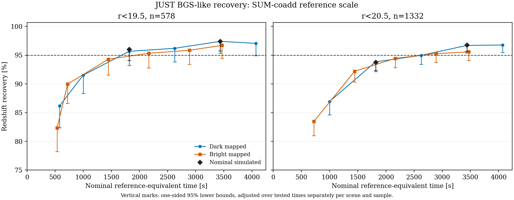

# JUST BGS 名义有效曝光时间及冷湖实际曝光估计

## 结论与口径

本研究为 JUST 建立了参考 DESI 的特征加权有效时间研究模型，并在设定的 4200 m 天顶标准场景下直接模拟和拟合 Redrock。标准场景采用 X=1、E(B−V)=0、无额外云消光、DECam-r 天空亮度 21.07 AB mag arcsec⁻²、FWHM=1.1″ at 6355 Å；对应 ETC 使用的 800 nm 参考 seeing 为 1.0505″。天光来自 ESO 多高度输入对 4200 m 的条件外推，按指定 r 亮度整体归一；它不是冷湖天光光谱实测。

样本为同一 DESI 深场挑选的 0.1<zVI<0.4 星系，总 BASS-r₀ 已作银河前景消光校正：r₀<19.5 为 578 个，r₀<20.5 为 1332 个。成功要求 Redrock ZWARN=0、DELTACHI2>40 和 |zfit−zVI|/(1+zVI)<0.0033；全部预选目标均计入分母。拟合输出 2664/2664 个；无结果也会计作失败。

这里的红移范围按既有 VI 参考红移选定，用于有条件的样本评价；真实巡天在测量前不能直接依靠未知的真红移实施相同筛选。

## 标准参考条件的直接模拟

| 样本 | 名义参考积分 [s] | 成功/总数 | 点估计 | 单侧 95% 下限，按两点校正 | 返回拟合 |
|---|---:|---:|---:|---:|---:|
| r<19.5 | 1817 | 555/578 | 96.02% | 94.09% | 578/578 |
| r<19.5 | 3436 | 563/578 | 97.40% | 95.76% | 578/578 |
| r<20.5 | 1817 | 1249/1332 | 93.77% | 92.33% | 1332/1332 |
| r<20.5 | 3436 | 1289/1332 | 96.77% | 95.68% | 1332/1332 |

下面的名义值是求和叠加模拟中**首次达到判据的已测参考场景快门时间点**；只测了 1817、3436 s，不能称为连续优化得到的最短时间。两个时间点由同一批目标之前的暗夜结果和信息量换算选定，下限虽然对这两个新时间点作 Bonferroni 校正，仍未覆盖样本选择、早先的自适应设计与模型误差。样本只来自单个深场，r₀<19.5 是事后子集。

| 样本 | 95% 判据 | 已测名义参考时间 [s] | 求和暗夜等 Q 预测 [s] | 求和亮夜等 Q 预测 [s] |
|---|---|---:|---:|---:|
| r<19.5 | 点估计 | 1817 | 1500 | 1875 |
| r<19.5 | 调整后下限 | 3436 | 3000 | 3564 |
| r<20.5 | 点估计 | 3436 | 3000 | 3564 |
| r<20.5 | 调整后下限 | 3436 | 3000 | 3564 |

表中亮／暗夜时间是模型的等信息量**预测**，不是这些精确时间点直接测得的 Redrock 成功率。模型采用 E(B−V)=0.05336 的代表性视线，而既有模拟使用每个星系实际 E(B−V)。累计快门时间按单次最多 750 s 分次，不含读出和换场开销。

这个分次模型在读出边界可能跳变，不能作为逐秒精确的运行停止规则。以名义 3436 s 为例，将色余从 r₀<19.5 的中位数 0.0533604 改为 r₀<20.5 的中位数 0.0536832，暗夜 3000 s 的 Q 仅比目标低约 0.11%，但新增第五次读出后首次等 Q 的预测从约 3000 s 跳到约 3236 s；亮夜预测则从约 3564 s 变为 3567 s。这是当前求和叠加和分次假设的敏感性，不是直接测得的成功率突变。详见 [边界敏感性记录](split_boundary_sensitivity.json)。

事实上，首次等 Q 反演在边界附近甚至不能保证名义条件下 t_eff=t_actual：例如名义时间 3000.001 s 会映射为约 2789 s。因此该实现是与现有求和模拟匹配的固定场景比较工具，不是已可部署的 DESI 式在线有效时间累计器。参见[分次边界示意图](coadd_boundary.png)。

## 连续加权候选及其曝光预测

另建的[逆协方差加权候选](weighted_effective_model.py)采用固定场景中每次曝光的独立光子／读噪及跨曝光相关天空残差，得到连续、单调的信息量；数值测试中名义条件的有效时间等于快门时间。下表把**求和叠加 Redrock 直接测试的参考深度**按相同标量 Q 转成加权参考的名义有效时间，然后换算暗、亮夜的加权快门时间。

| 样本 | 95% 判据 | 已测求和名义时间 [s] | 加权名义有效时间估计 [s] | 加权暗夜预测 [s] | 加权亮夜预测 [s] |
|---|---|---:|---:|---:|---:|
| r<19.5 | 点估计 | 1817 | 1759 | 1500 | 1845 |
| r<19.5 | 调整后下限 | 3436 | 3410 | 3000 | 3558 |
| r<20.5 | 点估计 | 3436 | 3410 | 3000 | 3558 |
| r<20.5 | 调整后下限 | 3436 | 3410 | 3000 | 3558 |

加权时间均为基于等 Q 的**模型估计**：本次 Redrock 光谱并非以该加权方法生成，同一标量 Q 也尚未证明对应相同的红移成功率。参考 E(B−V)=0.05336；实际条件按上述 4200 m 场景，单次最多 750 s。该模型目前只处理三个固定场景，不是根据实时条件变化的在线 ETC。关于边界、协方差和验算见 [模型说明](MODEL_zh.md)、[加权模型核查](weighted_model_audit.json)。

既有暗夜锚点的单独间接换算保存在 [间接估计表](indirect_weighted_thresholds.csv)。

## 与已有亮／暗夜直接测试对照

在 4200 m 场景下，暗夜月亮低于地平线，亮夜为 50% 月面照亮、月高 45°、月—目标角距 60°；均采用 X=1.2 和 FWHM=0.8″ at 800 nm。模型 DECam-r 天光分别约 21.50 和 20.82 AB mag arcsec⁻²。下表为此前实际运行的时间网格，不是本次等信息量换算值。

这些实际情景的 seeing 优于名义参考条件，暗夜的 r 天光也更暗；因此暗夜快门时间可以短于对应的名义秒数。亮暗夜换算同时受波长依赖透过率、光纤耦合和分次噪声影响，不能仅用 r 天光亮度比例计算。

| 样本 | 场景 | 点估计首达 95% | 调整后下限首达 95% | 3600 s 直接模拟结果 |
|---|---|---:|---:|---|
| r<19.5 | dark | 1500 s | 3000 s | 561/578；下限 94.92% |
| r<19.5 | bright | 2250 s | 3600 s 内未确认 | 559/578；下限 94.48% |
| r<20.5 | dark | 3000 s | 3000 s | 1289/1332；下限 95.46% |
| r<20.5 | bright | 3000 s | 3600 s 内未确认 | 1273/1332；下限 94.08% |

r₀<19.5 的原网格对 6 个时间点校正，r₀<20.5 的原网格对 5 个时间点校正；区间不覆盖不同分组、场景或模型系统误差。样本选择、源谱和参考红移并非完全独立，也不能代表所有星系。红移恢复率和每个目标的可靠性不能由单个有效时间保证。

## 模型和验证

依照 [DESI 对谱特征进行加权的思路](https://arxiv.org/html/2209.14482#S4.SS14)，利用 110 个独立校准星系的 100 Å 中值滤波残差建立权重，以 1.5″ 半光半径的圆指数盘为参考源；该轮廓不同于 DESI 使用的 de Vaucouleurs 参考源。模型计算源、天空、暗电流、读出噪声与 1% 相关天空残差，对实际和参考场景解等信息量方程。Qiu 实测大气消光约束 400–790 nm，红蓝两端采用压力调整的 ESO 后备透过率。仪器使用现有工程值（包括 4 e⁻/像元读噪、7 像元抽取宽度和 1.362″ 光纤），不是最新硬件验收值。

这 110 个权重训练星系来自 r₀<19.5、0.13<zVI<0.37 的校准子集，与测试目标不重叠；同一代理权重用于 r₀<20.5 的换算，对较暗星系的适用性仍需检验。

为保持与既有模拟一致，本次沿用 Qiu 表格与 ESO 的分段拼接，并未采用之后构造的 [Qiu 约束平滑大气候选](../atmosphere_qiu_calibrated_20261115/README_zh.md)；两种方案对红移成功率的差别尚未验证。Qiu 表项是有限波宽的消光斜率，插值透射并非高分辨率实测光谱。

固定天空及其他条件，只替换源大气透过率时，平滑候选使代理信息量 Q 在名义 3436 s、暗夜 3000 s 和亮夜 3600 s 分别增加约 1.48%、1.83% 和 1.96%，主要来自 Z 臂；X=1 采用光学深度与 airmass 成正比的近似。这个[代理量敏感性比较](smooth_atmosphere_sensitivity.json)不能直接解释为 Redrock 成功率变化或时间误差。

直接比较既有暗夜 3000 s 与亮夜 3600 s，模型总信息量相差约 1.4%，但 B/R/Z 的亮夜／暗夜信息量比分别为 0.812/0.901/1.073；同一 1332 星系的成功数为 1288 和 1273。因此**单一有效时间在两种天空下尚未验证为统一红移成功率指标**。使用弱线星系构造权重得到的亮夜换算也更长；详细结果见 [模型说明](MODEL_zh.md)、[标准与实际情景的逐目标配对检查](nominal_scene_paired_checks.csv)、[分组结果](nominal_subgroup_success.csv) 和 [权重敏感性](model_sensitivity.csv)。

标准场景与仪器响应的数值一致性、逐像元模拟、两点输入与 Redrock 输出身份已核查；第一个 8 星系试跑对 48 个波段／时间组合逐项重建，信号、逆方差、掩膜与 LSF 均一致。求和模型的已选网格点恒等、背景受限极限及消光方向检查通过；边界附近的恒等失效如上文所述。加权候选另通过边界连续性及名义恒等检查。这些检查不替代冷湖天空光谱、仪器吞吐、真实星系入纤以及观测红移成功率的现场标定。

## 文件与参考

- [模型定义、参数、方程和调用方法](MODEL_zh.md)；[直接名义结果](nominal_success_curves.csv)；[求和预测时间表](nominal_validated_thresholds.csv)；[加权候选时间表](weighted_thresholds.csv)；[既有暗夜间接估计](indirect_weighted_thresholds.csv)；[亮暗夜已有曲线](mapped_recovery_curves.csv)。
- [完整逐目标结果](nominal_individual_results.csv)；[独立统计核查](nominal_independent_audit.json)；[运行检查点](nominal_run/v2/progress.json)；[复现清单](nominal_analysis_manifest.json)；[PDF 图](nominal_recovery.pdf)。
- [DESI BGS 设计](https://arxiv.org/html/2208.08512#S4.SS1)、[DESI survey operations](https://arxiv.org/html/2306.06309#S5.SS2)、[DESI 光谱处理和 TSNR](https://arxiv.org/html/2209.14482#S4.SS14)、[Qiu et al. 冷湖消光](https://arxiv.org/abs/2606.18804)。
- 数据与图形工作流参考 [Kassis et al. 2026, Scientific Agent Skills](https://doi.org/10.48550/arXiv.2609.00065)。
