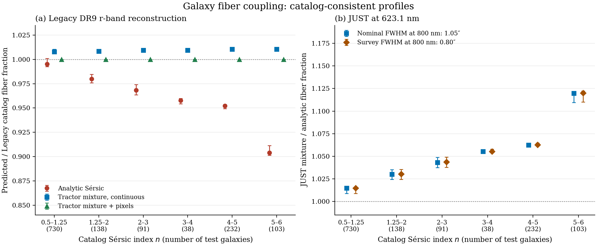

# 高 Sérsic 指数星系的入纤流量：Legacy 差异溯源与 JUST 模型

日期：2026-11-21。研究只计算确定性的入纤比例及光谱源响应，没有运行 Redrock，也没有重新估算红移成功率或曝光时间。

## 结论

上一版把 Legacy 星表的 `SERSIC`、`SHAPE_R`、`SHAPE_E1/2` 直接代入总流量归一化的解析 Sérsic 轮廓。实际星表采用的是 [Tractor DR9.4 的高斯混合轮廓](https://github.com/dstndstn/tractor/blob/dr9.4/tractor/sersic.py)：其径向分布与相同参数的无限解析 Sérsic 不完全一样，SER 的高指数情况还含有中心点状项。因此，高指数星系的解析模型与 Legacy `FIBERFLUX_R` 有系统差异。使用对应混合轮廓可以去掉绝大部分差异；剩余约 1% 主要是 Legacy 的像元采样和孔径测光定义。

测试集中 `n >= 5` 有 103 个星系，下表是预测光纤流量 / 星表光纤流量的中位数，全部使用同一批星系、1.5 角秒直径光纤及 1 角秒 Gaussian 视宁度假设。

| 计算方法 | `n >= 5`（103 个） | 全部测试星系（1332 个） |
| --- | ---: | ---: |
| 上一版解析 Sérsic（连续孔径） | 0.9039 | 0.9916 |
| Tractor DR9.4 混合轮廓（连续孔径） | 1.0105 | 1.0091 |
| Tractor 混合轮廓 + Legacy 像元化孔径 | 1.0000 | 1.0000 |

像元化重建与星表值在 1332 个测试星系中全部相差小于 0.1%，最大相对差为 0.0981%；其中 1330 个小于 0.01%。七个实际 Legacy 图砖中，匹配到 67 个目标（其中 56 个属于测试集，8 个具有 `n >= 5`），采用图砖原始子像元位置重新计算的 67 个对象最大相对差为 1.38×10⁻⁷。全样本的子像元位置由天区位置和 DR9 图砖 WCS 重建；在这 67 个目标上，重建位置与图砖位置的最大差异为 2.28×10⁻¹³ 像元。

这是对**同一星表生成方式的自洽重建**，不是独立实测验证，也不保证真实 JUST 入纤流量达到这样的精度。



图中左侧各模型与 Legacy 星表预测值比较；右侧比较同一星系在 JUST 几何下新混合轮廓与上一版解析轮廓。点为星系分组中位数，误差棒为星系之间的 16–84 百分位范围，并非置信区间。各组括号内是测试星系数；最后一组为 `n >= 5`。数值见 [星表重建逐目标数据](catalog_reconstruction_per_target.csv)和 [JUST 逐目标数据](just_mixture_coupling.csv)。

## 差异的物理与算法来源

1. **实际数据版本。** 全部 1332 个测试目标的 DESI TARGETID 均解码为 Legacy DR9 North 的 imaging release 9011。总体版本文档提及 Tractor `dr9.5`，但所查 7 个实际图砖 FITS header 都记录 `dr9.4`；其中 6 个 legacypipe 版本为 DR9.6.2，1 个为 DR9.6.7。DR9.4 与 DR9.5 中用于本检查的轮廓系数一致，本报告以实际图砖记录的 DR9.4 为基准。原始图砖、相应源码、许可证和 SHA-256 均保留在 `reference/` 和 [匹配记录](matched_legacy_bricks.json)中。
2. **高斯混合轮廓。** Tractor 的 SER 轮廓由不同宽度的归一化 Gaussian 组成，并根据 Sérsic 指数增加一项中心点源。对 `n >= 5` 子样本，仅保留混合轮廓而去掉中心点源时，连续孔径预测 / 星表的中位数约为 0.9752；加入中心项后为 1.0105，中心项自身使连续孔径预测的中位数提高约 3.65%。余下的变化来自各 Gaussian 分量和解析 Sérsic 的径向分布不同，以及极小的视宁度换算口径差异。这里的比较不把两项效应当作可独立相加的固定百分比。
3. **像元化孔径。** Legacy [legacypipe 的 `get_fiber_fluxes`](https://github.com/legacysurvey/legacypipe/blob/DR9.6.2/py/legacypipe/runbrick.py)在 0.262 角秒像元网格上对 PSF 卷积模型进行采样，再根据圆形孔径与像元的重叠测光；参考模型使用 1.5 角秒直径和 sigma = 1/2.35 角秒的 Gaussian PSF。连续孔径和这一像元化定义并不完全相同：对于 103 个高指数测试星系，前者比星表中位数高约 1.05%。

对 `n = 6` 的例子，单位总流量的 Tractor 混合轮廓在星表 `SHAPE_R` 范围内的累计分数约为 0.5602，而解析 Sérsic 按定义为 0.5；在 8 倍该尺度内分别约为 0.9928 与 0.8960。这里 `SHAPE_R` 是星表轮廓的尺度参数，并不能在该近似下严格等同于混合轮廓的 50% 半光半径。**更正此前的推断：源码中的 `nre = 8` 用于确定渲染 patch 的范围；它不能作为“解析 Sérsic 被硬截断在 8 倍有效半径并重新归一化”的证据。**

## JUST 几何下的影响

新增的 `just_etc.mixture_fiber_coupling` 模块以混合分量的振幅、相对于 `SHAPE_R²` 的方差和星表椭率为输入，计算其与现有 JUST ETC 点扩散函数的卷积，并在连续光纤孔径上积分。JUST 的物理孔径计算不套用 Legacy 图像像元化处理。使用现有 JUST `spec.dat` 几何时，光纤直径约 1.362 角秒，中心偏移 0.03 角秒，视场中心；假定偏移方向沿星系主轴、形态不随波长变化。

在 623.1 nm，相对于上一版解析 Sérsic + 椭率模型的每目标入纤分数，新混合轮廓给出：

| 样本 | 个数 | 名义 seeing：800 nm 处 FWHM ≈ 1.05 角秒 | 巡天参考 seeing：800 nm 处 FWHM = 0.80 角秒 |
| --- | ---: | ---: | ---: |
| `n >= 5` | 103 | 中位数 1.1198；16–84 百分位 1.1095–1.1217 | 中位数 1.1199；16–84 百分位 1.1100–1.1223 |
| `r₀ < 19.5` | 578 | 中位数 1.0391 | 中位数 1.0392 |
| `r₀ < 20.5` | 1332 | 中位数 1.0149 | 中位数 1.0149 |

这里 `r₀` 是前景消光校正后的总 r 波段星等。两个 seeing 条件是在同一个光纤几何下比较；亮夜、暗夜若采用相同 seeing，则几何入纤比例相同，天光背景则不同。表格仅描述**源入纤比例**的变化，不能直接用来推断红移成功率、95% 所需时间，或者对 DESI–JUST 时间差做定量分解。

## 实现与验证

- `py/just_etc/mixture_fiber_coupling.py` 新增 `GaussianMixtureProfile`、连续孔径计算和 `compute_snr_with_mixture`。这些接口采用显式 opt-in，接受**总流量**光谱；原 ETC 和此前的解析 Sérsic 模型、冻结光谱结果保持不变。示例见仓库 `doc/usage.md`。
- `compare_tractor.py` 从保留的 DR9.4 源码中读取参数字面量，按形态区分 REX、EXP、DEV 和 SER；代码本身不要求安装 Tractor，也不将外部系数表直接嵌入通用 ETC 模块。
- `tractor_adapter.py` 为现有 4200 m 模拟器提供可选源响应适配器；在 4 个不同形态的真实输入星系、B/R/Z 三条臂共 12 个组合上，源响应与独立公式重建的最大相对误差为 4.45×10⁻¹⁶，LSF 卷积后的源计数一致。这个测试未生成随机噪声或调用 Redrock。
- 通用连续孔径计算与独立积分在 67 个已匹配图砖源上相对差小于 4.45×10⁻¹⁶。针对 8 个代表性和极端样本，21 个波长节点插值在 3 个额外波长的最大相对差为 8.31×10⁻⁵。
- 与 ETC 原始点源几何在 400、500、623.1、800、900 nm 及 0.8 角秒 seeing 下对照，PSF 混合近似的最大相对差约 0.53%。这是模型数值近似的一个已知量级，不是观测误差或所有情景的严格上限。
- `test_mixture_fiber_coupling.py`、`test_fiber_coupling.py`、`test_package.py`、`test_atmosphere_hook.py` 共 19 项测试通过；此前归档的 8 个关键输入及 13 个模拟器/图砖输入的 SHA-256 核对通过。详细结果见 [验证记录](mixture_verification.json)和 [星表重建摘要](catalog_reconstruction_summary.json)。

参考运行，工作目录为 `/Users/rain/just_etc`：

```sh
env PYTHONPATH=/Users/rain/just_etc/py PYTHONDONTWRITEBYTECODE=1 OPENBLAS_NUM_THREADS=1 OMP_NUM_THREADS=1 NUMBA_CACHE_DIR=/private/tmp/just_numba MPLCONFIGDIR=/private/tmp/just_fiber_mpl /Users/rain/miniconda3/envs/desi/bin/python -s -B doc/validation/lenghu_redshift_recovery_20261111/high_sersic_legacy_20261121/verify_mixture.py
```

生成图形遵循 Scientific Agent Skills 的 `scientific-visualization` 工作流程；软件参考：Kassis, Agarwal, He, Patel & Brueckner (2026), [Scientific Agent Skills](https://doi.org/10.48550/arXiv.2609.00065)。
