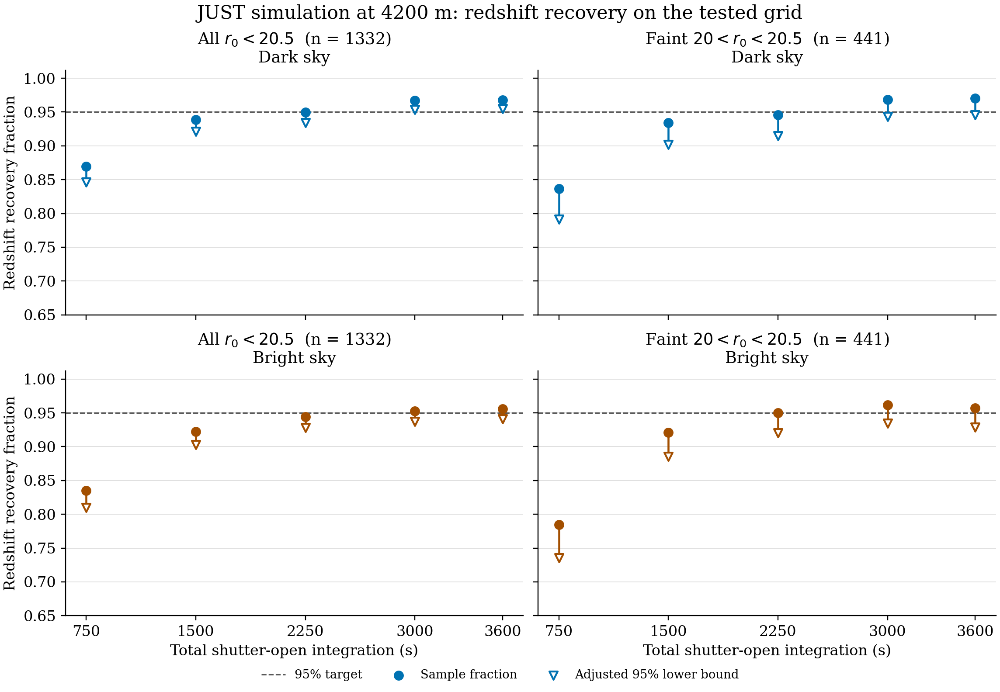

# JUST：r₀ < 20.5 的 4200 m 亮／暗夜红移恢复

## 样本与成功判据

共 1332 个测试星系：复用原有 r₀≤20 的 891 个，新增 20<r₀<20.5 的 441 个；r₀ 为银河系前景消光校正后的 BASS-r 总 AB 星等，0.1<z_VI<0.4。目标来自同一 DESI EDR 参考深场，经过参考谱、形态和模型质量筛选，不代表全部星系。

每个星系在每个情景都进入分母，包括无拟合结果者。成功要求 Redrock 返回有限红移、ZWARN=0、DELTACHI2>40，且 |z_fit−z_VI|/(1+z_VI)<0.0033。参考红移是 DESI VI，与构造模拟源谱的数据并非完全独立。质量阈值沿用原有较亮样本的校准检查；本次新增的 104 个较暗校准源没有拟合，尚未独立验证该阈值对较暗样本的表现。

## 全样本随曝光时间的结果

| 快门总积分 / s | 暗夜成功数 / 1332 | 暗夜成功率 | 暗夜调整后下限 | 亮夜成功数 / 1332 | 亮夜成功率 | 亮夜调整后下限 |
| ---: | ---: | ---: | ---: | ---: | ---: | ---: |
| 750 | 1158 | 86.94% | 84.64% | 1112 | 83.48% | 80.98% |
| 1500 | 1250 | 93.84% | 92.14% | 1228 | 92.19% | 90.32% |
| 2250 | 1265 | 94.97% | 93.40% | 1258 | 94.44% | 92.81% |
| 3000 | 1288 | 96.70% | 95.37% | 1269 | 95.27% | 93.74% |
| 3600 | 1289 | 96.77% | 95.46% | 1273 | 95.57% | 94.08% |

## 首次达到目标的已测时间

| 分组 | 夜空 | 目标 | 点估计 / s | 逐时间单侧下限 / s | 五时间校正后单侧下限 / s |
| --- | --- | ---: | ---: | ---: | ---: |
| 全部 r₀<20.5 | 暗夜 | 90% | 1500 | 1500 | 1500 |
| 全部 r₀<20.5 | 暗夜 | 95% | 3000 | 3000 | 3000 |
| 全部 r₀<20.5 | 亮夜 | 90% | 1500 | 1500 | 1500 |
| 全部 r₀<20.5 | 亮夜 | 95% | 3000 | 未确认 | 未确认 |
| 20<r₀<20.5 | 暗夜 | 90% | 1500 | 1500 | 1500 |
| 20<r₀<20.5 | 暗夜 | 95% | 3000 | 3000 | 未确认 |
| 20<r₀<20.5 | 亮夜 | 90% | 1500 | 2250 | 2250 |
| 20<r₀<20.5 | 亮夜 | 95% | 2250 | 未确认 | 未确认 |

主判据是单侧 95% Clopper–Pearson 统计下限达到目标，并在每个分组、每种天空内对五个时间点做 Bonferroni 校正。逐时间下限不做该校正；点估计达到目标不代表已按下限确认。若所有已测时间均未满足条件，记为“未确认”，这不等于证明真实最短时间大于 3600 s。各时间使用独立噪声实现及不同分次，成功率不保证单调，时间网格没有进行插值优化。

较暗子样本在 2250 s 时暗夜为 417/441（94.56%），亮夜为 419/441（95.01%）；亮夜比暗夜多成功 2 个目标，这是本次有限样本和噪声实现下的结果，不能据此认定亮夜更有利。两种天空在这一子样本中均未达到五时间校正后的 95% 下限。

## 3600 s 分组结果

| 分组 | 夜空 | n | 成功数 | 成功率 | 调整后下限 | t₉₅ 点估计 / s | t₉₅ 调整下限 / s |
| --- | --- | ---: | ---: | ---: | ---: | ---: | ---: |
| r₀≤19 | 暗夜 | 331 | 324 | 97.89% | 95.23% | 1500 | 3600 |
| r₀≤19 | 亮夜 | 331 | 322 | 97.28% | 94.41% | 2250 | 未确认 |
| 19<r₀≤20 | 暗夜 | 560 | 537 | 95.89% | 93.50% | 3000 | 未确认 |
| 19<r₀≤20 | 亮夜 | 560 | 529 | 94.46% | 91.79% | 未确认 | 未确认 |
| 20<r₀<20.5 | 暗夜 | 441 | 428 | 97.05% | 94.60% | 3000 | 未确认 |
| 20<r₀<20.5 | 亮夜 | 441 | 422 | 95.69% | 92.88% | 2250 | 未确认 |
| 0.1<z≤0.25 | 暗夜 | 663 | 637 | 96.08% | 93.95% | 3000 | 未确认 |
| 0.1<z≤0.25 | 亮夜 | 663 | 626 | 94.42% | 91.99% | 未确认 | 未确认 |
| 0.25<z<0.4 | 暗夜 | 669 | 652 | 97.46% | 95.66% | 2250 | 3000 |
| 0.25<z<0.4 | 亮夜 | 669 | 647 | 96.71% | 94.73% | 2250 | 未确认 |
| BPT 星形成候选 | 暗夜 | 604 | 589 | 97.52% | 95.62% | 1500 | 3000 |
| BPT 星形成候选 | 亮夜 | 604 | 584 | 96.69% | 94.58% | 2250 | 未确认 |
| 弱线老族候选 | 暗夜 | 292 | 286 | 97.95% | 95.08% | 1500 | 3000 |
| 弱线老族候选 | 亮夜 | 292 | 282 | 96.58% | 93.22% | 2250 | 未确认 |
| 其他／未归类 | 暗夜 | 436 | 414 | 94.95% | 91.96% | 未确认 | 未确认 |
| 其他／未归类 | 亮夜 | 436 | 407 | 93.35% | 90.04% | 未确认 | 未确认 |

“样本不足”表示即使该组全部成功，五时间校正后的下限也不能达到 95%。不同分组、天空和阈值没有再进行联合多重检验校正；交叉分组及光纤星等／颜色分组见 CSV。

## 3600 s 的质量通过及纯度

| 夜空 | 质量通过 | 正确复原 | 纯度及逐情景双侧 95% 区间 | 质量不合格 | 质量通过但错误 | 无结果 |
| --- | ---: | ---: | ---: | ---: | ---: | ---: |
| 暗夜 | 1290 | 1289 | 99.92% [99.57%, 100.00%] | 42 | 1 | 0 |
| 亮夜 | 1273 | 1273 | 100.00% [99.71%, 100.00%] | 59 | 0 | 0 |

纯度分母为质量通过数；区间只表示该情景内有限样本的统计不确定性。

## 模型与适用范围

使用既有冻结的 4200 m 条件化天光外推和 Qiu+ESO 大气拼接，而非后来构建的平滑大气候选；天空光谱不是冷湖现场实测光谱。参考条件为 airmass=1.2、800 nm 处 seeing FWHM=0.8″；暗夜月亮在地平线下，亮夜月面照亮约 50%、月亮高度 45°、月目标角距 60°。

沿用原 JUST ETC 仪器设定：175 μm 光纤入口直径、约 1.362″ 视场中心角直径，4 e⁻/pixel/read 读出噪声、7 空间像元等权抽取；这是工程基线，未确认为最终 JUST 设计。源形态近似圆形指数分布；Redrock 使用 JUST 理论 LSF 与逐源 DESI 参考分辨率矩的 Gaussian 近似组合的响应矩阵。模拟源谱按消光校正总星等归一，源响应再按各视线的 E(B−V) 单独施加银河系前景消光；几何吞吐量计算中的 ebv=0 不代表省略了这一逐源消光。

750、1500、2250、3000 s 分别为 1、2、3、4 次 750 s；3600 s 为 4×750+600 s。表中均是快门总积分，不含读出及其他观测开销。统计下限依赖所选深场样本近似独立同分布，不包含仪器、天光、大气、源谱选择或场间差异的系统误差。新增 8 星系试跑已事先查看，故本扩展分析不能描述为完全盲测。

## 产物与核验

- [逐时间及分组曲线](success_curves.csv)、[曝光阈值](exposure_thresholds.csv)、[逐源结果](individual_results.csv)。
- [独立统计核验](independent_audit.json)、[输入与结果清单](analysis_manifest.json)、[旧结果回归核对](old_analysis_reproduction.json)、[图表 PDF](recovery_20p5.pdf)。
- 可复现代码：[扫描驱动](../../run_extension.py)、[合并分析](../../analyze_20p5.py)、[独立审计](../../audit_20p5.py)、[作图](../../plot_20p5.py)、[报告生成](../../report_20p5.py)；[批次运行状态](../run/progress.json)。
- 图示为已测试的模拟网格点；圆点是样本成功率，空心倒三角是五时间点校正后的单侧 95% 下限。科学绘图检查参考 [Kassis et al. (2026), Scientific Agent Skills](https://arxiv.org/abs/2609.00065)。

