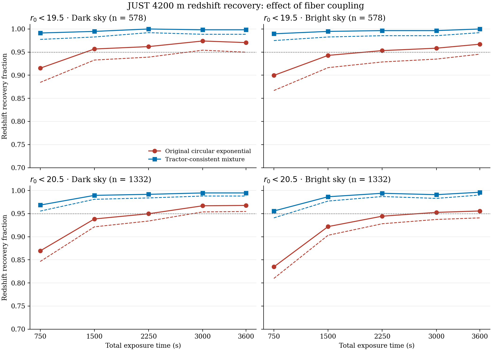

# JUST 4200 m：改进入纤模型后的红移恢复

以同一批冻结测试星系和亮夜/暗夜观测条件比较原圆形指数模型与新的 Tractor 一致混合轮廓。
星等 r₀ 为银河系前景消光校正后的总 BASS-r AB 星等；样本限定为 0.1 < z_VI < 0.4，来自 DESI 选定深场，并不代表全部相同星等范围的星系。
采用 4200 m 亮夜/暗夜参考天光、800 nm 处 0.8 角秒 seeing 和约 1.362 角秒光纤直径；结果是条件模拟。

## 达到 95% 成功率的首次测试时间

主要标准是成功率的单侧 95% Clopper–Pearson 下限达到 95%，在每个样本和夜空情景内对五个测试时间作 Bonferroni 校正（α=0.01）。
点估计首次达到 95% 的时间另列；表中时间均为测试网格点，不是连续最优值。

| 样本 | 天空 | 原模型：校正下限 | 新模型：校正下限 | 原模型：点估计 | 新模型：点估计 |
| --- | --- | ---: | ---: | ---: | ---: |
| r₀ < 19.5（578） | 暗夜 | 3000 s | 750 s | 1500 s | 750 s |
| r₀ < 19.5（578） | 亮夜 | 3600 s 内未确认 | 750 s | 2250 s | 750 s |
| r₀ < 20.5（1332） | 暗夜 | 3000 s | 750 s | 3000 s | 750 s |
| r₀ < 20.5（1332） | 亮夜 | 3600 s 内未确认 | 1500 s | 3000 s | 750 s |

按这一置信标准，两个样本分别需要至少 562 / 578 和 1284 / 1332 个成功红移。

## 每个曝光时间的结果

每项为成功数 / 全部目标数、成功率和五时间校正后的单侧 95% 下限；未返回结果计入分母。通过质量筛选的红移纯度及其双侧 95% 置信区间保存在曲线数据表中。

### r₀ < 19.5

| 天空 | 总积分时间 | 原模型 | 新模型 |
| --- | ---: | --- | --- |
| 暗夜 | 750 s | 529/578：91.52%（下限 88.45%） | 573/578：99.13%（下限 97.75%） |
| 暗夜 | 1500 s | 553/578：95.67%（下限 93.28%） | 575/578：99.48%（下限 98.27%） |
| 暗夜 | 2250 s | 556/578：96.19%（下限 93.91%） | 578/578：100.00%（下限 99.21%） |
| 暗夜 | 3000 s | 563/578：97.40%（下限 95.42%） | 577/578：99.83%（下限 98.86%） |
| 暗夜 | 3600 s | 561/578：97.06%（下限 94.98%） | 577/578：99.83%（下限 98.86%） |
| 亮夜 | 750 s | 520/578：89.97%（下限 86.69%） | 572/578：98.96%（下限 97.50%） |
| 亮夜 | 1500 s | 545/578：94.29%（下限 91.64%） | 575/578：99.48%（下限 98.27%） |
| 亮夜 | 2250 s | 551/578：95.33%（下限 92.87%） | 576/578：99.65%（下限 98.55%） |
| 亮夜 | 3000 s | 554/578：95.85%（下限 93.49%） | 576/578：99.65%（下限 98.55%） |
| 亮夜 | 3600 s | 559/578：96.71%（下限 94.55%） | 578/578：100.00%（下限 99.21%） |

### r₀ < 20.5

| 天空 | 总积分时间 | 原模型 | 新模型 |
| --- | ---: | --- | --- |
| 暗夜 | 750 s | 1158/1332：86.94%（下限 84.64%） | 1290/1332：96.85%（下限 95.55%） |
| 暗夜 | 1500 s | 1250/1332：93.84%（下限 92.14%） | 1318/1332：98.95%（下限 98.10%） |
| 暗夜 | 2250 s | 1265/1332：94.97%（下限 93.40%） | 1321/1332：99.17%（下限 98.39%） |
| 暗夜 | 3000 s | 1288/1332：96.70%（下限 95.37%） | 1325/1332：99.47%（下限 98.80%） |
| 暗夜 | 3600 s | 1289/1332：96.77%（下限 95.46%） | 1325/1332：99.47%（下限 98.80%） |
| 亮夜 | 750 s | 1112/1332：83.48%（下限 80.98%） | 1273/1332：95.57%（下限 94.08%） |
| 亮夜 | 1500 s | 1228/1332：92.19%（下限 90.32%） | 1314/1332：98.65%（下限 97.71%） |
| 亮夜 | 2250 s | 1258/1332：94.44%（下限 92.81%） | 1324/1332：99.40%（下限 98.70%） |
| 亮夜 | 3000 s | 1269/1332：95.27%（下限 93.74%） | 1320/1332：99.10%（下限 98.29%） |
| 亮夜 | 3600 s | 1273/1332：95.57%（下限 94.08%） | 1327/1332：99.62%（下限 99.02%） |

实线为成功率点估计，虚线为对五个时间点校正后的单侧 95% 下限，水平点线为 95%。
各时间情景使用独立种子，因此曲线不必严格单调。

## 匹配比较与验证

同一目标、天空和总时间的旧新结果分别配对；下表为新模型首次按主要标准达标时的变化。若 3600 s 内未确认，列出 3600 s 的配对结果。

| 样本 | 天空 | 配对时间 | 旧失败、新成功 | 旧成功、新失败 |
| --- | --- | ---: | ---: | ---: |
| r₀ < 19.5 | 暗夜 | 750 s | 44 | 0 |
| r₀ < 19.5 | 亮夜 | 750 s | 52 | 0 |
| r₀ < 20.5 | 暗夜 | 750 s | 132 | 0 |
| r₀ < 20.5 | 亮夜 | 1500 s | 86 | 0 |

独立审计复核了 40 条曲线记录、13320 个旧新配对情景，并逐像元比较 39960 条光谱臂掩膜，其中 0 条不同。另检查了掩膜计数，有效像元数不同的记录为 0 条。

两次运行使用相同冻结目标、真值、天光、仪器、底层 LSF 输入和种子规则；改变的是源入纤模型，并据新的源响应重新计算相应的分辨率矩阵。新模型以 Legacy Tractor 轮廓与 JUST 连续光纤孔径相卷积。
现有 ETC 点扩散函数的高斯混合近似，在五个验证波长与原点源几何的最大相对差约为 0.53%；这不是台址或仪器系统误差的完整界限。
置信下限只反映所选样本内的条件统计误差；源谱构造、参考红移、台址模型和仪器设计的系统不确定性不包括在内。

逐目标数据、曲线、配对转移和运行摘要分别见 [individual_results.csv](individual_results.csv)、[success_curves.csv](success_curves.csv)、[paired_outcomes.csv](paired_outcomes.csv)、[independent_audit.json](independent_audit.json)、[pixel_mask_audit.json](pixel_mask_audit.json) 和 [WORK_LOG.md](../WORK_LOG.md)。

图表及 FITS 工作流参考：Kassis et al. (2026), [Scientific Agent Skills](https://doi.org/10.48550/arXiv.2609.00065)。
