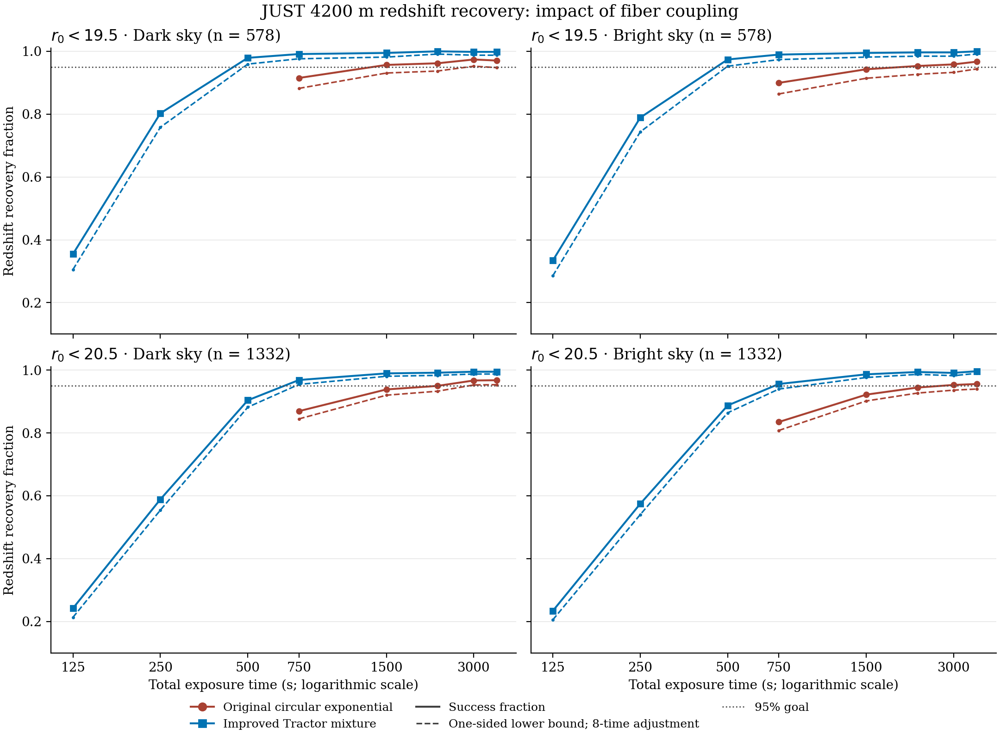

# JUST 4200 m：改进入纤模型后的红移恢复

使用同一批冻结测试星系和亮夜、暗夜参考条件，对比原圆形指数轮廓和新的 Tractor 一致混合轮廓。
星等 r₀ 为银河系前景消光校正后的总 BASS-r AB 星等；真值范围为 0.1 < z_VI < 0.4。r₀ < 19.5 的 578 个星系是 r₀ < 20.5 的 1332 个星系的子集。样本选自 DESI 的特定深场，并经过参考光谱、红移、形态和模型质量筛选；它不能直接代表全部同星等星系，也可能欠代表现实中难测的目标。

## 达到 95% 成功率的首次测试时间

主要标准：单侧 Clopper–Pearson 成功率置信下限达到 95%。对每个样本及天空条件，按八个时间点进行 Bonferroni 校正（每点 α = 0.05/8）；旧模型只有其中 750–3600 s 的五个结果，也使用相同的保守校正。125、250、500 s 是看到 750 s 的亮样本结果后新增的，须将这一顺序纳入结果解释。
表中的时间是首次达标的测试点，不是连续时间搜索得到的精确最小值。点估计列为不使用置信下限时首次达到 95% 的时间。

| 样本 | 天空 | 原模型：校正下限 | 新模型：校正下限 | 原模型：点估计 | 新模型：点估计 | 新模型在主要时点的成功数 / 总数（校正下限） |
| --- | --- | --- | --- | --- | --- | --- |
| r₀ < 19.5（578） | 暗夜 | 3000 s | 500 s | 1500 s | 500 s | 566/578 = 97.92%（95.94%） |
| r₀ < 19.5（578） | 亮夜 | 3600 s 内未确认 | 500 s | 2250 s | 500 s | 563/578 = 97.40%（95.26%） |
| r₀ < 20.5（1332） | 暗夜 | 3000 s | 750 s | 3000 s | 750 s | 1290/1332 = 96.85%（95.44%） |
| r₀ < 20.5（1332） | 亮夜 | 3600 s 内未确认 | 1500 s | 3000 s | 750 s | 1314/1332 = 98.65%（97.64%） |

该校正标准在两个样本中分别要求至少 562/578 和 1285/1332 个成功红移。
125、250、500、750 s 都按单次曝光计算；更长的总时间以约 750 s 为分次参考。红移成功需 `ZWARN=0`、`DELTACHI2>40`，且与参考红移满足 |Δz|/(1+z_VI)<0.0033。质量阈值借用 DESI BGS 参考切选，尚未在 JUST 上独立校准。所有预选目标都进入分母，包括无拟合结果、未通过质量筛选和错误红移。
每个测试时点使用独立噪声种子，曲线不要求严格单调；置信区间采用同组目标近似独立同分布的条件模型，未涵盖大气、天光、仪器和源模型系统误差，也未对不同样本和天空组再次做整体校正。

## 通过质量筛选结果的纯度

纯度是通过质量筛选的红移中与参考红移一致的比例；括号为该时点双侧 95% 精确置信区间，未针对时间选择作多重校正。若 3600 s 内未确认达标，列出 3600 s。

| 样本 | 天空 | 时间 | 一致数 / 通过质量筛选数 | 纯度（95% 区间） |
| --- | --- | ---: | ---: | --- |
| r₀ < 19.5 | 暗夜 | 500 s | 566/566 | 100.00%（99.35%–100.00%） |
| r₀ < 19.5 | 亮夜 | 500 s | 563/563 | 100.00%（99.35%–100.00%） |
| r₀ < 20.5 | 暗夜 | 750 s | 1290/1291 | 99.92%（99.57%–100.00%） |
| r₀ < 20.5 | 亮夜 | 1500 s | 1314/1315 | 99.92%（99.58%–100.00%） |

实线是成功率点估计；虚线是单侧 95% 下限并对八个时点校正；水平点线是 95%。横轴为对数刻度。原模型未测 750 s 以下。

## 750 s 的逐目标配对变化

| 样本 | 天空 | 旧失败、新成功 | 旧成功、新失败 | 两者均失败 | 前者的新/旧入纤比例中位数 |
| --- | --- | ---: | ---: | ---: | ---: |
| r₀ < 19.5 | 暗夜 | 44 | 0 | 5 | 3.59 |
| r₀ < 19.5 | 亮夜 | 52 | 0 | 6 | 3.08 |
| r₀ < 20.5 | 暗夜 | 132 | 0 | 42 | 2.17 |
| r₀ < 20.5 | 亮夜 | 161 | 0 | 59 | 2.04 |

入纤比例是在 623.1 nm、800 nm 处 seeing = 0.8 角秒时计算的源光比例；它不是独立的因果分解。原模型使用圆形指数轮廓，新模型同时加入星表椭率、形态和 Tractor 混合轮廓，所以不能把全部差异归因于高 Sérsic 指数修正。
在 r₀ < 19.5 的上述转变星系中，暗夜 44 个有 8 个 n ≥ 5，亮夜 52 个有 11 个 n ≥ 5；混合轮廓与上一版解析椭圆 Sérsic 的入纤比例中位数分别为 1.059 和 1.062。这是几何比较，上一版解析轮廓没有重新运行 Redrock。
对完整亮样本的旧圆形轮廓加密并扩展积分网格后，623.1 nm 入纤比例的绝对相对变化中位数为 0.041%，最大为 2.35%；这个数值误差不足以解释上表的数倍差异。逐目标数据见 [original_quadrature_per_target.csv](../early_bright/original_quadrature_per_target.csv)。

## 观测条件和验证

新旧共同时间点使用同一目标及源谱、天光、仪器、底层 LSF 和随机种子规则，并逐目标施加银河系前景消光；新入纤响应对应的源泊松噪声与标定分辨率矩阵重新计算。
采用既有 4200 m 亮夜/暗夜外推天光模型、原 Qiu+ESO 分段大气消光模型、airmass = 1.2、1.362 角秒光纤及 0.03 角秒偏心；假定 seeing 在 800 nm 为 0.8 角秒，并使用暂定的 4 e⁻/像元/次读出噪声和 7 像元等权抽取宽度。暗夜参考情景月亮在地平线以下；亮夜参考情景月面照亮约 50%、月亮高度 45°、月目标角距 60°。未替换为后续的平滑衔接大气候选模型。表中均是实际积分时间，结果是条件模拟而非 JUST 实测性能。
完整扫描核查了 21312 个新模型情景及 52 条统计记录。旧、新模型在共同五个时间点逐一比较了 39960 条光谱臂掩膜，其中不同的有 0 条；原模型 5 星系 / 50 情景的同输入重拟合核查结果为 passed。
输入光谱和参考红移并非完全独立；入纤计算假定星系形态不随波长变化且偏心沿星系主轴。在 Legacy 的参考 seeing 和孔径定义下，对全部 1332 个目标作像元化星表光纤流量重建，最大相对差约 0.098%；这是星表生成方法的自洽检验，不等于对真实 JUST 入纤流量的在天标定。连续 JUST 孔径与 Legacy 的像元化测量定义也不同；详见[入纤模型检验](../../high_sersic_legacy_20261121/REPORT_zh.md)。新轮廓使用的 PSF 混合近似与原 ETC 点源计算在五个测试波长的最大相对差约 0.53%。

完整逐目标结果、逐时点成功率及置信区间、首次达标时点和独立审计见 [individual_results.csv](individual_results.csv)、[success_curves.csv](success_curves.csv)、[exposure_thresholds.csv](exposure_thresholds.csv)、[independent_audit.json](independent_audit.json)；阈值表也保留 90% 的辅助结果，共同时间点的配对结果见 [paired_outcomes.csv](../analysis/paired_outcomes.csv)。

运行与模型来源见 [WORK_LOG.md](../WORK_LOG.md)；图表工作流参考 Kassis et al. (2026), [Scientific Agent Skills](https://doi.org/10.48550/arXiv.2609.00065)。
